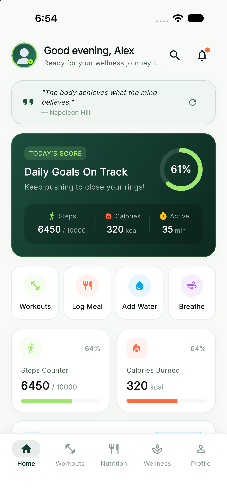
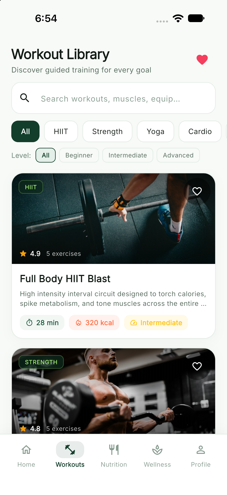
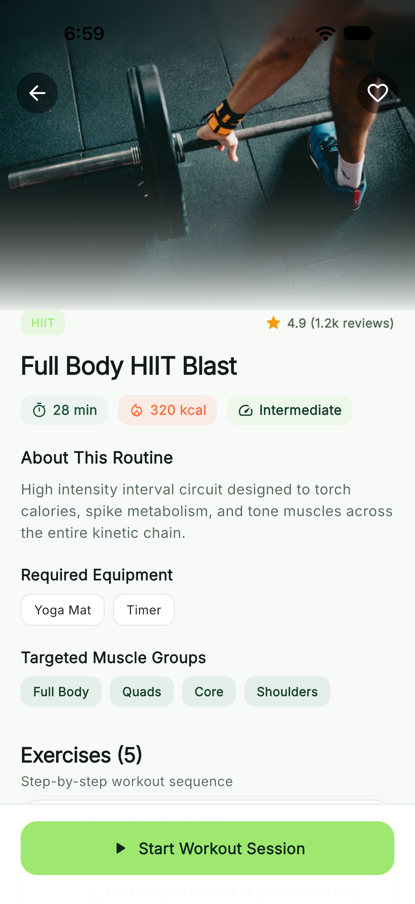
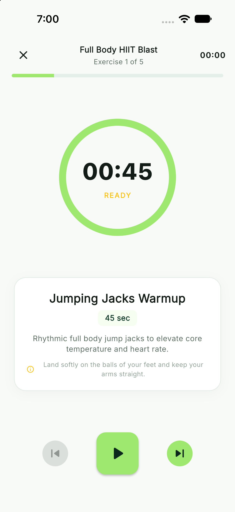
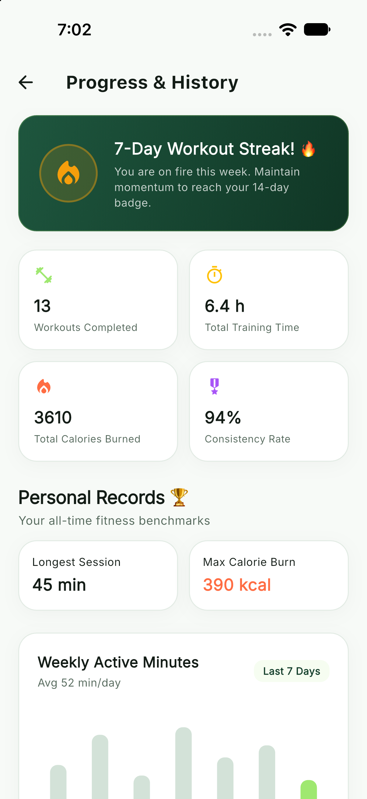
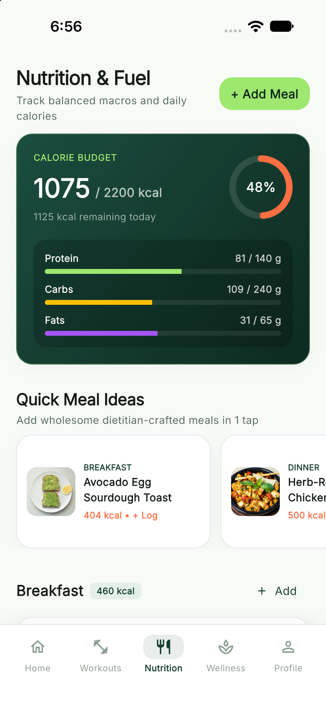
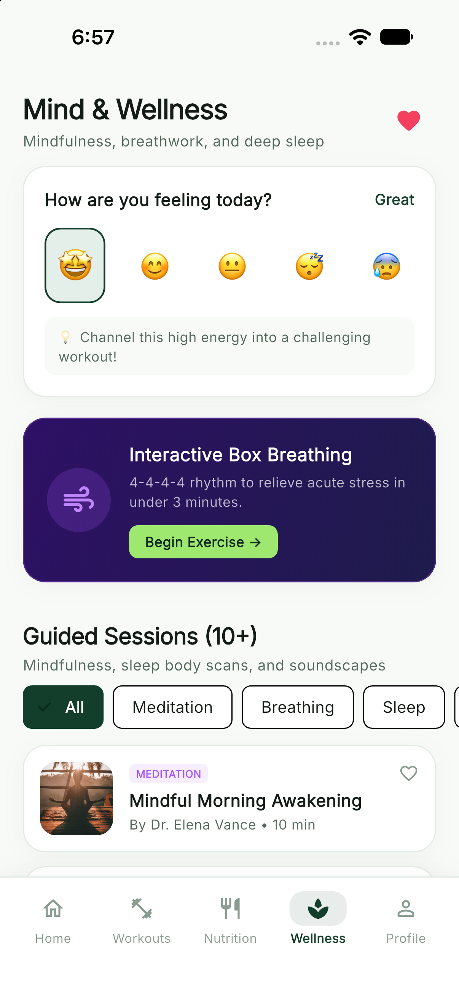
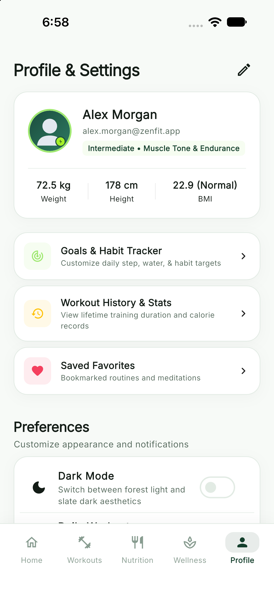
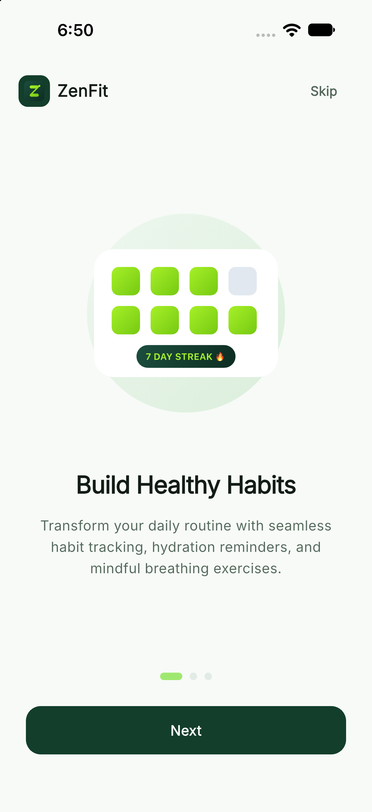

# ZenFit — Move Better. Feel Better. Live Better.

> **ZenFit** is a modern Flutter fitness and wellness application featuring workout tracking, nutrition planning, mindfulness activities, habit building, and personalized progress insights, powered by realistic mock data and local persistence.

---

## Table of Contents
- [1. Project Overview](#1-project-overview)
- [2. Key Features](#2-key-features)
- [3. Screens and Functionality](#3-screens-and-functionality)
- [4. Visual Showcase & Genuine Screenshots](#4-visual-showcase--genuine-screenshots)
- [5. Technology Stack](#5-technology-stack)
- [6. Architecture & Folder Structure](#6-architecture--folder-structure)
- [7. Mock Data Strategy](#7-mock-data-strategy)
- [8. Local Persistence Details](#8-local-persistence-details)
- [9. Prerequisites](#9-prerequisites)
- [10. Installation Instructions](#10-installation-instructions)
- [11. How to Run the App](#11-how-to-run-the-app)
- [12. How to Run Tests](#12-how-to-run-tests)
- [13. How to Build an Android APK](#13-how-to-build-an-android-apk)
- [14. How to Build for iOS](#14-how-to-build-for-ios)
- [15. Packages and Dependencies](#15-packages-and-dependencies)
- [16. Known Limitations](#16-known-limitations)
- [17. Future Improvements](#17-future-improvements)
- [18. Contribution Guidelines](#18-contribution-guidelines)
- [19. License](#19-license)

---

## 1. Project Overview

**ZenFit** is a production-style, multi-screen mobile application engineered in **Flutter and Dart**. Built from the ground up to embody a wellness aesthetic, it pairs a **deep forest green** primary tone with a vibrant **lime green** energetic accent, delivering fluid Material 3 ergonomics, intuitive micro-interactions, and instant local responsiveness.

ZenFit is completely autonomous:
- **No backend servers, Firebase accounts, or paid API keys are required.**
- All 20+ workouts, 20+ food ingredients, 10+ balanced meals, 10+ mindfulness sessions, and 14 days of activity metrics run on deterministic local mock models with live calculative business logic.
- User changes—including custom habits, water increments, logged meals, active workout sessions, favorite bookmarks, and profile modifications—persist reliably using lightweight `SharedPreferences`.

---

## 2. Key Features

- **Dynamic Interactive Dashboard**: Time-of-day greeting, motivational quotes, animated progress rings for daily step goals, active minutes, calories burned, and 1-tap quick water tracking (+250 ml).
- **Weekly Activity Visualizer**: Interactive bar chart built with `fl_chart`, detailing 7-day caloric expenditure and active training minutes with dynamic tooltips.
- **20+ Workout Library**: Search by workout name, filter by category (*Strength*, *Cardio*, *Yoga*, *HIIT*, *Stretching*), and filter by difficulty (*Beginner*, *Intermediate*, *Advanced*).
- **Interactive Workout Player**: Lifecycle-safe timer session manager with active countdowns, rest breaks, pause/resume/skip controls, exercise progressions, and automatic completion logging to user history.
- **Comprehensive Nutrition Planner**: Daily calorie target tracker with real-time remaining budget calculations, macronutrient breakdowns (Protein, Carbohydrates, Fats), and an interactive **Add Meal** logging modal.
- **Mindfulness & Box Breathing Studio**: Mood check-in engine with actionable recommendations, 10+ guided meditations, and an interactive **4-4-4-4 Box Breathing** visual timer with smooth breath-pacer animations.
- **Goal & Habit Tracker**: Customizable targets for steps, water, training, and active minutes, paired with an interactive 7-day habit completion matrix.
- **Bookmarks & Favorites**: Quick-bookmark workouts and meditation sessions with persistent local state and designated empty states.
- **Notification Center**: Filterable mock activity alerts, hydration reminders, and streak updates with read/clear capabilities.
- **Profile & Wellness Metrics**: Editable sample profile (height, weight, fitness goals) with auto-computed BMI categories, units selection, and a working **Dark / Light Theme** switcher.
- **Instant Demo Reset**: 1-tap demo state restoration to easily review and evaluate initial onboarding and fresh data states.

---

## 3. Screens and Functionality

| Screen | Description |
| :--- | :--- |
| **Splash Screen** | Branded animated ZenFit emblem, tagline reveal, and automatic first-run onboarding vs. returning-user routing. |
| **Onboarding** | 3-step carousel exploring healthy habits, smart training, and holistic wellness tracking with skip, next, and finish actions. |
| **Home Dashboard** | Hero progress rings, 1-tap hydration logger, daily workout spotlight, 7-day `fl_chart` bar chart, and habit reminders. |
| **Workout Library** | Real-time search, category pill selector, difficulty chips, duration/calorie badges, and instant bookmark toggles. |
| **Workout Details** | Rich imagery, equipment chips, target muscle groups, exercise sequence list, and a prominent session launcher. |
| **Active Workout** | Safe interval countdown timer, play/pause/skip navigation, exercise instructions, and session completion logger. |
| **Progress & History** | 7-day streak badge, lifetime training hours, total calorie burns, personal records, and historical workout log. |
| **Nutrition & Fuel** | Calorie budget ring, dynamic macro progress bars, quick-add meal suggestions, and an interactive food logging dialog. |
| **Mind & Wellness** | 5-point emotional mood check-in, 4-4-4-4 Box Breathing guide with visual breath pacer, and 10+ guided meditations. |
| **Goals & Habits** | Editable daily targets, streak counters, and a 7-day interactive checkmark matrix for routine formation. |
| **Favorites** | Segmented view of saved routines and mindfulness sessions with persistent storage and empty-state feedback. |
| **Notifications** | Chronological feed of hydration nudges, goal completions, and routine suggestions with 1-tap dismiss. |
| **Profile & Settings** | Editable health metrics, automated BMI calculator, dark/light theme switch, and full demo data reset. |
| **Global Search** | Unified multi-category search spanning workouts, nutrition items, and wellness practices. |

---

## 4. Visual Showcase & Genuine Screenshots

All screenshots below are authentic captures from the live application running on an iOS Simulator.

| Home Dashboard | Workout Library | Workout Details |
| :---: | :---: | :---: |
|  |  |  |

| Active Workout Player | Progress & History | Nutrition & Macros |
| :---: | :---: | :---: |
|  |  |  |

| Mind & Wellness | Profile & Settings | Onboarding Carousel |
| :---: | :---: | :---: |
|  |  |  |

---

## 5. Technology Stack

- **Framework**: [Flutter](https://flutter.dev/) (Channel stable, 3.x) & [Dart](https://dart.dev/)
- **Design System**: Material Design 3 with custom color tokens:
  - Primary: Deep Forest Green (`#133E2B`)
  - Accent: Vibrant Lime Green (`#9FE870`)
  - Background Light: Clean Off-White (`#F7FAF8`)
  - Background Dark: Deep Slate Charcoal (`#0D1410`)
- **State Management & Navigation**: [GetX](https://pub.dev/packages/get) (`^4.6.6`) for decoupled reactive controllers and unified routing.
- **Typography**: [Google Fonts](https://pub.dev/packages/google_fonts) (`Poppins` and `Inter`).
- **Data Visualization**: [fl_chart](https://pub.dev/packages/fl_chart) (`^1.3.0`) for bar charts with interactive touch tooltips.
- **Local Persistence**: [shared_preferences](https://pub.dev/packages/shared_preferences) (`^2.5.3`) for lightweight, cross-platform key-value persistence.
- **Date & Number Formatting**: [intl](https://pub.dev/packages/intl) (`^0.20.2`).
- **Vector Assets**: [flutter_svg](https://pub.dev/packages/flutter_svg) (`^2.2.3`).

---

## 6. Architecture & Folder Structure

ZenFit follows a maintainable, feature-first clean architecture separating UI, presentation controllers, repositories, and domain models:

```
lib/
├── app/
│   ├── app.dart                    # GetMaterialApp root with theme & bindings
│   ├── bindings/
│   │   └── initial_binding.dart    # Dependency injection for repositories & controllers
│   ├── routes/
│   │   ├── app_pages.dart          # Route definitions and transitions
│   │   └── app_routes.dart         # Static route name constants
│   └── theme/
│       ├── app_colors.dart         # Forest green & lime brand color tokens
│       ├── app_text_styles.dart    # Google Fonts typography scale
│       └── app_theme.dart          # Material 3 Light & Dark ThemeData
├── core/
│   ├── constants/
│   │   └── app_constants.dart      # Storage keys, assets paths, and defaults
│   ├── services/
│   │   └── storage_service.dart    # SharedPreferences abstraction layer
│   ├── utils/
│   │   └── date_formatter.dart     # Formatter utility functions
│   └── widgets/                    # Reusable atomic UI components
│       ├── app_network_image.dart  # Fallback-resilient image renderer
│       ├── custom_button.dart      # Primary, accent, outline, text buttons
│       ├── custom_card.dart        # Styled cards with subtle border & shadows
│       ├── empty_state_view.dart   # Polished empty-state indicator
│       ├── metric_badge.dart       # Pill badges for calories, duration, difficulty
│       ├── progress_ring.dart      # Circular progress indicator with center labels
│       └── section_header.dart     # Section title with optional action button
├── data/
│   ├── mock/                       # Deterministic offline mock seed datasets
│   │   ├── mock_activity.dart      # 7-day daily activity & 14-day history
│   │   ├── mock_foods.dart         # 21 realistic food ingredients with macros
│   │   ├── mock_habits.dart        # 6 sample wellness habits with 7-day logs
│   │   ├── mock_meals.dart         # 10 dietitian-crafted sample meals
│   │   ├── mock_meditations.dart   # 10 mindfulness and breathwork sessions
│   │   ├── mock_notifications.dart # 8 notification updates
│   │   ├── mock_user.dart          # Default user profile model
│   │   └── mock_workouts.dart      # 20 full workouts with exercise sets
│   ├── models/                     # Strongly typed immutable Dart models
│   │   ├── activity_summary_model.dart
│   │   ├── exercise_model.dart
│   │   ├── food_item_model.dart
│   │   ├── goal_model.dart
│   │   ├── habit_model.dart
│   │   ├── meal_model.dart
│   │   ├── notification_model.dart
│   │   ├── user_profile_model.dart
│   │   ├── wellness_model.dart
│   │   ├── workout_history_model.dart
│   │   └── workout_model.dart
│   └── repositories/               # Data access layer & business operations
│       ├── activity_repository.dart
│       ├── nutrition_repository.dart
│       ├── user_repository.dart
│       ├── wellness_repository.dart
│       └── workout_repository.dart
├── features/
│   ├── active_workout/             # Lifecycle-safe workout timer & progress
│   ├── favorites/                  # Bookmarked workouts & meditations
│   ├── goals/                      # Daily targets & weekly habit tracker
│   ├── home/                       # Dashboard, daily rings, fl_chart bar graph
│   ├── navigation/                 # 5-tab indexed bottom navigation
│   ├── notifications/              # Alerts center with filter & clear
│   ├── nutrition/                  # Daily calorie budget, macros, meal logger
│   ├── onboarding/                 # 3-step carousel with persistence check
│   ├── profile/                    # User stats, BMI calculation, theme switch
│   ├── progress/                   # Workout streaks, lifetime stats, records
│   ├── search/                     # Unified multi-category search
│   ├── splash/                     # Animated logo splash
│   ├── wellness/                   # Box breathing timer & mindfulness player
│   ├── workout_details/            # Routine breakdown & exercise sequence
│   └── workouts/                   # Category pills, difficulty filter, library
└── main.dart                       # Entry point: async service initialization & launch
```

---

## 7. Mock Data Strategy

ZenFit delivers a rich first-launch experience using deterministic, localized datasets:
- **20 Workouts**: Covering HIIT, Strength, Yoga, Cardio, and Stretching across Beginner, Intermediate, and Advanced tiers.
- **21 Food Items & 10 Sample Meals**: Complete with realistic calories, protein, carb, and fat distributions.
- **10 Mindfulness Sessions**: Across guided meditation, acute stress relief, sleep soundscapes, and morning focus.
- **7 Days of Daily Activity Logs & 14 Historical Sessions**: Providing realistic baseline data for charts and progress analytics.
- **6 Habits with 7-Day Completion History**: Simulating authentic daily streaks.
- **8 Preloaded Notifications**: Informing users of hydration, workout milestones, and wellness suggestions.

*All metrics are calculated dynamically through presentation controllers and repositories.*

---

## 8. Local Persistence Details

ZenFit utilizes `StorageService` built atop `SharedPreferences` to persist user updates without requiring cloud authentication:
- **Onboarding Flag**: Prevents repeated onboarding after first launch.
- **Theme Mode**: Persists user selection between Light and Dark modes.
- **Water Intake**: Logs daily millilitres logged via the quick-add widget.
- **Meal Logs**: Stores custom meals added during the day.
- **Workout Bookmarks**: Persists favorite workout IDs.
- **Wellness Bookmarks**: Persists saved meditation routine IDs.
- **User Goals & Habits**: Retains modified step, water, active-minute goals and habit completions.
- **User Profile**: Persists edited name, age, height, weight, and fitness tier.

---

## 9. Prerequisites

To run or build ZenFit, ensure your environment meets these requirements:
- **Flutter SDK**: `^3.22.0` or later
- **Dart SDK**: `^3.4.0` or later
- **Android Development**: Android Studio, Android SDK (API 34 recommended)
- **iOS Development**: macOS with Xcode 15+ and CocoaPods installed

---

## 10. Installation Instructions

1. Clone or download the repository:
   ```bash
   cd /path/to/zenfit
   ```

2. Fetch all required Flutter dependencies:
   ```bash
   flutter pub get
   ```

3. Verify static analysis and formatting:
   ```bash
   dart format --output=none --set-exit-if-changed .
   flutter analyze
   ```

---

## 11. How to Run the App

### On iOS Simulator
```bash
# List available simulators
xcrun simctl list devices available

# Run on booted or specific simulator
flutter run -d booted
```

### On Android Emulator or Connected Device
```bash
flutter run
```

### Selecting Release or Profile Mode
```bash
flutter run --profile
flutter run --release
```

---

## 12. How to Run Tests

ZenFit contains a comprehensive suite of unit and widget tests covering repositories, calculations, and components:

```bash
flutter test
```

### Test Coverage Highlights
- `test/workout_repository_test.dart`: Validates workout retrieval, category filtering, difficulty queries, and favorite persistence.
- `test/nutrition_repository_test.dart`: Validates food catalog access, macro summation algorithms, and meal logging.
- `test/goals_calculations_test.dart`: Validates goal progress calculations, habit streak logic, and edge-case capping.
- `test/widget_test.dart`: Validates atomic UI widgets (`CustomButton`, `MetricBadge`, `SectionHeader`).

---

## 13. How to Build an Android APK

Build a self-contained release APK:
```bash
flutter build apk --release
```
The output file will be generated at `build/app/outputs/flutter-apk/app-release.apk`.

To build an Android App Bundle (AAB) for Google Play:
```bash
flutter build appbundle --release
```

---

## 14. How to Build for iOS

Building for iOS requires macOS with Xcode installed.

1. Ensure CocoaPods dependencies are configured:
   ```bash
   cd ios
   pod install
   cd ..
   ```

2. Build the iOS archive:
   ```bash
   flutter build ipa --release
   ```

*Note: For device deployment and App Store submission, configure your Apple Developer Team ID and signing certificates inside Xcode.*

---

## 15. Packages and Dependencies

| Package | Version | Purpose |
| :--- | :--- | :--- |
| `get` | `^4.6.6` | Reactive state management, dependency injection, and routing |
| `google_fonts` | `^6.2.1` | Modern typography (Poppins & Inter) |
| `shared_preferences` | `^2.2.3` | Local persistent key-value storage |
| `fl_chart` | `^1.3.0` | Performant interactive charts and visualizations |
| `intl` | `^0.20.2` | Date, time, and number formatting |
| `flutter_svg` | `^2.2.3` | Resolution-independent SVG asset rendering |
| `cupertino_icons` | `^1.0.8` | iOS system iconography |

---

## 16. Known Limitations

- **Frontend Mock Mode**: Current metrics (step count, calories burned, sleep) are calculated from local deterministic models rather than live hardware sensors (Apple HealthKit / Google Health Connect).
- **Offline Images**: The app includes bundled SVG vectors and resilient gradient fallbacks; high-resolution photography loads dynamically from secure Unsplash CDNs when network access is available.
- **Audio Playback**: The guided meditation player presents visual and timed phase guides; integration with background audio engines (such as `just_audio`) can be added in future iterations.

---

## 17. Future Improvements

- [ ] Apple HealthKit and Google Health Connect sensor synchronization.
- [ ] Voice-guided coaching and background audio playback for meditations.
- [ ] Barcode scanning for instant nutritional logging via OpenFoodFacts API.
- [ ] Cloud sync and social fitness challenges with friends.
- [ ] Wearable companion app (watchOS and Wear OS).

---

## 18. Contribution Guidelines

Contributions are welcome! Please follow these steps:
1. Fork the repository.
2. Create your feature branch (`git checkout -b feature/amazing-feature`).
3. Commit your changes (`git commit -m 'Add amazing feature'`).
4. Ensure all tests pass (`flutter test` and `flutter analyze`).
5. Push to your branch (`git push origin feature/amazing-feature`).
6. Open a Pull Request.

---

## 19. License

This project is licensed under the **MIT License**. See the [LICENSE](LICENSE) file for details.

---

*Crafted with 💚 for mindful fitness and holistic wellness.*
